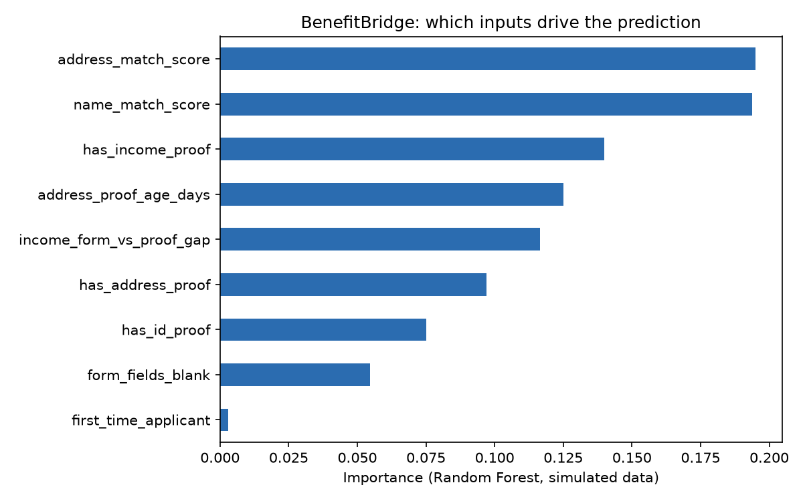

# BenefitBridge

An AI-assisted application-readiness checker. It predicts why a public-benefit
application is likely to be rejected or sent back as incomplete BEFORE it is
submitted, shows the evidence, and gives the applicant a prioritized action checklist.

## The problem
People miss out on benefits they qualify for because of missing documents,
mismatched details or hard-to-follow requirements.

## What it does
1. Takes application details (documents attached, name/address match, document age,
   income gap, blank fields).
2. Predicts the most likely reason the application would fail.
3. Explains the evidence behind the warning.
4. Returns a ranked checklist of fixes.

## Important: data is simulated
All data is synthetic and generated by rules in the script. The high accuracy
(about 98%) therefore reflects how the data was created, NOT real-world
performance. Validating this needs real rejection data.

## How to run
Requires Python 3 with numpy, pandas and scikit-learn.

    python3 benefitbridge.py

It trains a Random Forest, prints a classification report, and shows an example
application with its action checklist. I ran it on an IBM LinuxONE (s390x) virtual
machine inside a JupyterLab container.

## Example output

Rejection risk: 0.98 | Likely reason: expired_address_proof
1. Replace address proof with one dated within the last 90 days.
2. Make the name on the form match your ID exactly.

## Built with
Python, scikit-learn, pandas, numpy. Written with help from an AI assistant (Claude).

## Feature importance



The model relies on the same factors the simulator's rules use (match
scores, proof documents, document age). `first_time_applicant` scores
near zero because the simulator never uses it, which is a useful sanity
check that the model is learning the rules rather than noise. This is
expected with simulated data and is not evidence of real-world
performance. The risk score comes from the model, while the evidence and
checklist use explicit rules, so every recommendation can be traced.

## How to run
```bash
pip install -r requirements.txt
python benefitbridge.py
```

The script generates simulated applications, trains a Random Forest,
prints evaluation results, and shows a sample readiness report with an
action checklist. It runs on any machine with Python 3.9+, and I tested
it on an IBM LinuxONE (s390x) virtual server.

## Limitations

- All data is simulated, so the accuracy figures are not real-world.
- This is a readiness checker, not an eligibility decision.
- Real use would need real data, fairness testing and human review.
